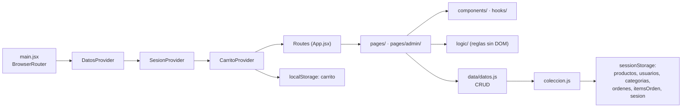
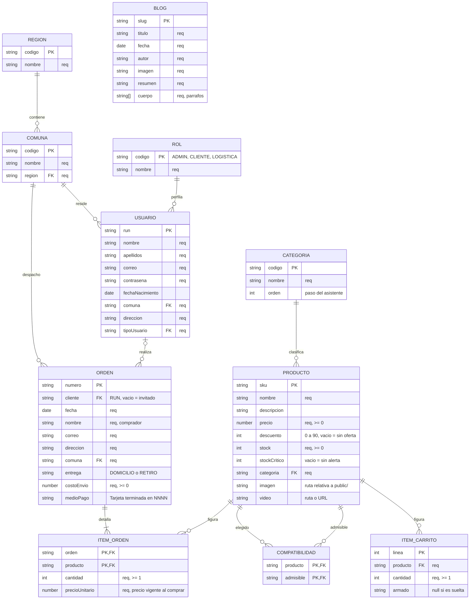

# Ensambla.me

Tienda online de componentes de PC con asistente de armado guiado por compatibilidad.
Frontend React + Vite y, aparte, un backend simple en Spring Boot con MariaDB (sección 11).
Duoc UC · DSY1104 Desarrollo Fullstack II · Entrega II.
ERS rev. 3.0 (26-10-2026), Daniel Muñoz. La versión formal IEEE 830 está en
`ERS - Ensambla.me.docx`.

## Índice

- [1. Ejecución](#1-ejecución)
- [2. Stack y restricciones](#2-stack-y-restricciones)
- [3. Arquitectura](#3-arquitectura)
  - [3.1 Composición de vistas](#31-composición-de-vistas)
  - [3.2 Estado en el cliente](#32-estado-en-el-cliente)
  - [3.3 Roles](#33-roles)
- [4. Modelo de datos](#4-modelo-de-datos)
- [5. Reglas de validación](#5-reglas-de-validación)
- [6. Requisitos funcionales](#6-requisitos-funcionales)
- [7. Requisitos no funcionales](#7-requisitos-no-funcionales)
- [8. Fuera de alcance](#8-fuera-de-alcance)
- [9. Desviaciones respecto del Anexo 1](#9-desviaciones-respecto-del-anexo-1)
- [10. Pruebas](#10-pruebas)
- [11. Backend (API REST)](#11-backend-api-rest)

## 1. Ejecución

Aplicación React + Vite. Requiere Node ≥ 22.22.

```
npm install
npm run dev        # http://localhost:5173/
npm test           # Vitest en modo watch (npm run test:run: una sola pasada)
npm run coverage   # cobertura v8: tabla en consola + coverage/index.html
npm run build      # salida en dist/
npm run lint
```

Rutas de la app: `/`, `/productos` (filtros en la URL: `?q=`, `categoria`, `min`, `max`,
`oferta`, `stock`, `orden`), `/productos/:sku`, `/categorias`, `/ofertas`, `/armado`,
`/carrito`, `/checkout`, `/pago/correcto/:numero`, `/pago/error`, `/blogs`, `/blogs/:slug`,
`/nosotros`, `/contacto`, `/registro`, `/login`, `/creditos`, `/perfil` y `/mis-compras`
(`/mis-compras/:numero`, con sesión) y el panel en `/admin` (`/admin/productos`,
`/admin/productos/criticos`, `/admin/categorias`, `/admin/usuarios`, `/admin/ordenes`,
`/admin/reportes` y `/admin/perfil`, con `nuevo`/`nueva`, `:id/editar` y la ficha
`/admin/usuarios/:run` en los mantenedores). Imágenes y video se sirven desde `public/resources/`.

La capa de datos (`src/data/datos.js`) ofrece CRUD completo de productos, usuarios y
categorías, y la creación de órdenes, sobre una copia de trabajo en `sessionStorage`;
`DatosProvider` la conecta con los componentes para que cada cambio se vea sin recargar.

El sitio de la Entrega I (HTML, CSS y JS sin framework) se conserva en `legacy/` como
referencia; `legacy/resources` es un enlace simbólico a
`public/resources`. Requiere un servidor HTTP: con `file://` no carga las secciones que
se traen con `fetch()`.

```
python3 -m http.server 8000   # desde la raíz del repo
# http://localhost:8000/legacy/pages/index.html
```

En `backend/` hay una API REST aparte (Spring Boot, Java 21 y MariaDB en Docker) con categorías,
productos y usuarios. La aplicación React **no la usa**: sigue con los datos simulados de
`src/data/`. Cómo ejecutarla: [sección 11](#11-backend-api-rest).


| Rol                     | Correo             | Contraseña   |
|-------------------------|--------------------|--------------|
| Administrador           | `admin@duoc.cl`    | `admin1234`  |
| Administrador logístico | `bodega@duoc.cl`   | `bodega123`  |
| Cliente                 | `camila@gmail.com` | `cliente123` |

Pago simulado en `/checkout` (no hay cobro real ni se guarda la tarjeta). Tarjetas de
prueba: `4242 4242 4242 4242` aprueba, `4000 0000 0000 0002` la rechaza el emisor y
`4000 0000 0000 9995` por fondos insuficientes. Cualquier vencimiento futuro (MM/AA) y
un CVV de 3 o 4 dígitos. Se puede comprar sin sesión; con sesión, los datos se completan
solos. Cada compra crea una orden con su boleta y descuenta el stock.

## 2. Stack y restricciones

- React 19 con Vite 8 (módulos ES, JSX), React Router 8 para la navegación y Bootstrap
  5.3.8 instalado por npm (`bootstrap/dist/css/bootstrap.min.css`), sin CDN.
- Pruebas con Vitest 5, Testing Library y jsdom. Lint con ESLint 10. Node ≥ 22.22.
- El frontend no usa backend ni base de datos: los datos viven en `src/data/` (semillas y CRUD)
  y en Web Storage. El backend de la sección 11 es un proyecto aparte que todavía no se conecta.
- Sin peticiones HTTP propias en el frontend: no hay `fetch()` ni APIs externas.
- Una hoja de estilos propia (`src/styles/style.css`), sin atributos `style=""`.
- HTML semántico dentro de los componentes. Diseño responsivo con la grilla de Bootstrap.
- Navegadores objetivo: Chrome, Firefox y Edge en sus versiones actuales.

## 3. Arquitectura



### 3.1 Composición de vistas

`App.jsx` envuelve las rutas en tres proveedores de contexto, de afuera hacia adentro:
`DatosProvider` (listas y CRUD, y vuelve a renderizar tras cada cambio),
`SesionProvider` (sesión del usuario) y `CarritoProvider` (carrito y avisos). Las rutas
se agrupan en tres diseños (`components/layout/Layouts.jsx`): tienda con barra lateral de
categorías, tienda sin barra lateral y panel de administración. Las vistas protegidas
usan `RutaProtegida`.

```
src/
├── main.jsx, App.jsx
├── pages/            Inicio, Productos, Producto, Categorias, Ofertas, Armado, Carrito,
│   │                 Checkout, PagoCorrecto, PagoError, Perfil, MisCompras, MiCompra,
│   │                 Blogs, Blog, Nosotros, Contacto, Registro, Login, Creditos,
│   │                 NoEncontrada
│   └── admin/        Resumen, Productos, FormularioProducto, Criticos, Categorias,
│                     FormularioCategoria, Usuarios, Usuario, FormularioUsuario,
│                     Ordenes, Orden, Reportes
├── components/       Alerta, Boleta, BotonAgregar, CajaBusqueda, Campo, CampoCorreo,
│   │                 EstadoVacio, FiltrosCatalogo, ImagenProducto, Indicador,
│   │                 ModalConfirmacion, PrecioProducto, RejillaProductos, ResumenPedido,
│   │                 RutaProtegida, SelectRegionComuna, TablaBarras, TablaOrdenes,
│   │                 TarjetaProducto, Toasts
│   └── layout/       Header, Nav, Aside, AsideAdmin, Footer, Layouts
├── context/          datos, sesion, carrito (contexto y hook) + sus *Provider.jsx
├── hooks/            useFormulario, useCriterios, useEliminacion, useTitulo
├── logic/            armado, busqueda, carrito, catalogo, checkout, ordenes, pago,
│                     precios, reportes, stock (reglas puras, sin DOM ni almacenamiento)
├── data/             semillas.js (datos de prueba), coleccion.js, datos.js (CRUD)
├── utils/            formato, recursos, validaciones
├── styles/style.css
└── setupTests.js, testUtils.jsx, *.test.js(x) (junto al archivo que prueban)
public/resources/     img/ (productos/<SKU>.webp, SVG), video/ensamblame.mp4
```

### 3.2 Estado en el cliente

| Almacén          | Clave                                            | Contenido                                                                        | Vida                                       |
|------------------|--------------------------------------------------|----------------------------------------------------------------------------------|--------------------------------------------|
| `localStorage`   | `carrito`                                        | JSON `[{linea, producto, cantidad, armado}]` (`armado` es `null` en las sueltas). Si es corrupto, se reinicia vacío | Persistente; no se borra al cerrar sesión  |
| `sessionStorage` | `sesion`                                         | RUN, nombre, apellidos, correo y rol                                             | Hasta el logout o el cierre del navegador  |
| `sessionStorage` | `productos`, `usuarios`, `categorias`, `ordenes`, `itemsOrden` | Copia de trabajo sembrada desde `semillas.js`, donde escribe el CRUD de `datos.js` | Sesión del navegador                       |

`coleccion.js` lee la colección del almacenamiento en cada consulta y la escribe completa
en cada cambio. Si el contenido no se puede leer, vuelve a la semilla.

### 3.3 Roles

| Rol                     | Acceso                                                                                                                      |
|-------------------------|-----------------------------------------------------------------------------------------------------------------------------|
| Cliente                 | Tienda pública, compra con o sin sesión, `/perfil` y `/mis-compras`                                                         |
| Administrador           | Todo lo anterior y el panel completo: Resumen, Productos, Críticos, Categorías, Usuarios, Órdenes, Reportes y Mi perfil     |
| Administrador logístico | Productos (solo lectura), Críticos, Órdenes (solo lectura) y Mi perfil. El resto del menú no existe en el DOM               |

`RutaProtegida roles={[…]}`: sin sesión redirige a `/login?destino=…`; con un rol no
autorizado muestra «Acceso denegado» y no renderiza la vista. Tras iniciar sesión, el
Administrador llega a `/admin`, el logístico a `/admin/productos` y el cliente a `/`.

## 4. Modelo de datos

Nombres de campo idénticos a los de `semillas.js`. `"req"` = obligatorio.



| Datos                                                                  | Origen                                    | Escritura                                                                                 |
|------------------------------------------------------------------------|-------------------------------------------|-------------------------------------------------------------------------------------------|
| `compatibilidad`, `regiones`, `comunas`, `roles`, `blogs`              | Constantes de `semillas.js`               | Solo lectura                                                                              |
| `productos`, `usuarios`, `categorias`, `ordenes`, `itemsOrden`         | Semilla en `semillas.js`                  | Copia de trabajo en `sessionStorage` mediante `coleccion.js`; el CRUD está en `datos.js`  |
| Ítem carrito                                                           | —                                         | `localStorage.carrito` (`context/carrito.js`, reglas en `logic/carrito.js`)               |

- Las operaciones de escritura de `datos.js` aplican las reglas de negocio y devuelven
  `{ ok, registro, mensaje }`; con `ok` en `false` no cambian nada. `DatosProvider` vuelve a
  renderizar tras cada cambio exitoso.
- Formatos de clave:
  - Comuna: `RM-02`, generada como región más índice.
  - Orden: `ORD-2026-0001`, correlativo dentro del año de la fecha de compra.
  - Armado: `ARM-<Date.now() en base 36>`.
  - RUN con el DV incluido, sin puntos ni guion.
- Fechas en ISO `YYYY-MM-DD`.
- Los precios incluyen IVA (19 %). La orden guarda el precio vigente de cada ítem
  (con la oferta aplicada) porque el precio del producto puede cambiar después.
- Una orden de invitado tiene `cliente` vacío y se ve con su enlace; las de una cuenta las
  ve su dueño y el personal (`logic/ordenes.js: puedeVerOrden`).
- `compatibilidad` se genera con `flatMap` a partir del mapa `paresDeCompatibilidad`
  (SKU → SKU admisibles de la categoría siguiente).
- Armado no es una relación propia: es el valor `armado` que comparten las líneas de
  carrito de un mismo grupo.
- No se almacenan derivados: total de la orden, subtotal, IVA y precio del armado se
  calculan al mostrarse. La región del usuario se obtiene de su comuna.
- El modelo está en 3NF, salvo `Blog.cuerpo`, que se guarda como `string[]` por
  simplicidad. En una base de datos real sería la relación Párrafo (`blog`, `n`, `texto`).

## 5. Reglas de validación

La validación es en tiempo real (al escribir y al salir del campo) y el error aparece junto
al campo. Al enviar se validan todos y se enfoca el primero inválido. Cada campo con
formato muestra una sugerencia (`form-text`) antes de cualquier error. Las reglas están en
`utils/validaciones.js` y las aplica `hooks/useFormulario.js`.

| Campo                     | Regla                                                                                     |
|---------------------------|-------------------------------------------------------------------------------------------|
| RUN                       | Requerido, 7–9 caracteres, sin puntos ni guion, DV módulo 11. Ej. válido: `190110222`     |
| Correo                    | Requerido, ≤ 100, dominio `@duoc.cl`, `@profesor.duoc.cl` o `@gmail.com` (con `datalist`) |
| Contraseña                | Requerida, 4–10 caracteres, `type="password"`                                             |
| Cambio de contraseña      | Actual, nueva (4–10) y repetición requeridas; la nueva debe coincidir y ser distinta de la actual |
| Nombre / apellidos        | Requeridos, ≤ 50 / ≤ 100                                                                  |
| Región → comuna           | Requeridas; el select de comuna se filtra por la región elegida                           |
| Dirección                 | Requerida, ≤ 300                                                                          |
| Fecha de nacimiento       | Opcional                                                                                  |
| Contacto: nombre / comentario | Requeridos, ≤ 100 / ≤ 500                                                             |
| SKU                       | Requerido, ≥ 3, único                                                                     |
| Nombre / descripción de producto | Requerido ≤ 100 / opcional ≤ 500                                                   |
| Precio                    | Requerido, ≥ 0, admite decimales; 0 = gratis                                              |
| Descuento                 | Opcional, entero de 0 a 90; vacío o 0 = sin oferta                                        |
| Stock / stock crítico     | Requerido / opcional; enteros ≥ 0                                                         |
| Categoría (de producto)   | Requerida (select)                                                                        |
| Imagen / video            | Opcionales (ruta o URL)                                                                   |
| Código de categoría       | Requerido, 3–30, solo minúsculas, números y guiones; único                                |
| Nombre de categoría       | Requerido, ≤ 50                                                                           |
| Tarjeta                   | Requerida, 13–19 dígitos (se aceptan espacios) con dígito de control Luhn                 |
| Vencimiento               | Requerido, `MM/AA`, mes 01–12 y no anterior al mes actual                                 |
| Código de seguridad       | Requerido, 3 o 4 dígitos, `type="password"`                                               |

## 6. Requisitos funcionales

El código cita los criterios como `RF-xx CAn`. La numeración es estable y RF-16 queda
retirado. RF-17 a RF-27 se agregan en la Entrega II. Los archivos van relativos a `src/`.

**RF-01 Registrar usuario** · Cliente · `pages/Registro.jsx`, `utils/validaciones.js`
1. Si falta un campo requerido, no se envía y se marca cada campo faltante.
2. `190110222` se acepta. Con puntos, guion o DV incorrecto (`19.011.022-3`) aparece
   «RUN inválido» y no se envía.
3. Con un dominio no permitido (`juan@hotmail.com`), el error lista los dominios
   aceptados.
4. Una contraseña fuera de 4–10 caracteres da error.
5. Al cambiar la región, el select de comuna se recarga solo con las de esa región.
6. No se pueden superar los máximos; si se superan, aparece el error.
7. Un formulario válido agrega el usuario como Cliente y muestra una confirmación. Un RUN
   o un correo ya registrados se rechazan.
8. El correo ofrece los dominios permitidos vía `datalist`.

**RF-02 Iniciar sesión** · todos · `pages/Login.jsx`, `context/SesionProvider.jsx`
1. Con credenciales válidas se inicia sesión y se redirige a la vista que se pidió
   (`?destino=`, solo rutas del mismo sitio) o, si no hay, según el rol: Cliente →
   tienda; Administrador → panel (RF-10, RF-11); Logístico → RF-12.
2. Un dominio inválido o una contraseña fuera de 4–10 caracteres dan error y no se
   envía.
3. Sin coincidencia aparece un mensaje genérico, «correo o contraseña incorrectos».

**RF-03 Catálogo** · Cliente · `pages/Inicio.jsx`, `pages/Productos.jsx`, `components/RejillaProductos.jsx`, `components/TarjetaProducto.jsx`
1. Hay una tarjeta (imagen, nombre, categoría, precio) por producto, generada desde los
   datos: agregar un producto lo muestra sin tocar los componentes.
2. Precios en CLP.
3. Sin productos aparece un aviso en lugar de un área en blanco.

**RF-04 Detalle de producto** · Cliente · `pages/Producto.jsx`
1. Un clic en la tarjeta abre el detalle de ese producto.
2. El detalle muestra imagen, nombre, precio, descripción, categoría, stock y un «Añadir al
   carrito» operativo.
3. Un SKU inexistente muestra «producto no encontrado», sin error de JS.
4. Si existe `video`, se embebe y se reproduce. Si no existe, no queda ningún
   contenedor vacío.

**RF-05 Agregar al carrito** · Cliente · `components/BotonAgregar.jsx`, `context/CarritoProvider.jsx`, `logic/carrito.js`

Invariante: las unidades de un SKU en el carrito, sumando líneas sueltas y armados,
nunca superan su `stock`.
1. Añadir, desde el listado o el detalle, suma 1 al contador y persiste de inmediato
   en `localStorage`.
2. Un SKU ya presente incrementa su cantidad; no se duplica la línea.
3. Cada adición tiene confirmación visual.
4. Con `stock` 0, el botón queda deshabilitado con «Sin stock», en el listado y en el
   detalle.
5. Si se excede el stock, se rechaza con las unidades disponibles y el carrito no
   cambia (con stock 2, la 3.ª unidad se rechaza).

**RF-06 Gestionar carrito** · Cliente · `pages/Carrito.jsx`, `logic/carrito.js`
1. Cada línea muestra imagen, nombre, precio unitario, cantidad y subtotal.
2. Al eliminar una línea, se quita y el total se recalcula sin recargar.
3. Al cambiar la cantidad se recalculan el subtotal y el total (Σ precio vigente ×
   cantidad). El mínimo es 1 y el máximo es el stock menos las otras líneas del mismo SKU;
   un valor mayor se ajusta al máximo con un mensaje.
4. El carrito persiste tras recargar o reabrir el navegador. Si el stock bajó, la
   cantidad se ajusta y la línea sin unidades se quita.
5. Vacío: muestra un mensaje, el total es 0 y «Ir a pagar» queda deshabilitado.

**RF-07 Asistente de armado** · Cliente · `pages/Armado.jsx`, `logic/armado.js`, `logic/carrito.js`

Orden: CPU → placa madre → RAM → almacenamiento → fuente → gabinete → refrigeración →
GPU → periféricos. Modos *completo* y *módulos*. El filtrado sale de la tabla estática
`Compatibilidad`, sin cálculo técnico real.
1. Una categoría a la vez, en orden fijo.
2. La categoría siguiente lista solo los admisibles del componente elegido (una CPU
   de un socket no ofrece placas de otro).
3. En modo módulos se puede finalizar antes y se agregan solo los componentes
   elegidos.
4. En modo completo, recorrer todas las categorías agrega el conjunto completo.
5. En el carrito, el armado es un grupo identificable, con detalle de componentes y
   precio igual a la suma.
6. No se emite juicio técnico: si la tabla asocia dos componentes, se aceptan.
7. Un componente con stock 0 aparece como «sin stock» y no se puede elegir. Si al
   finalizar falta stock (RF-05), el armado no se agrega y se nombran los componentes
   faltantes.

**RF-08 Contacto** · Cliente · `pages/Contacto.jsx`
1. Con nombre, correo o comentario vacíos no se envía y aparece el error en cada campo.
2. Con un dominio no permitido, el error lista los dominios aceptados.
3. No se puede pasar de nombre > 100 ni de comentario > 500; si se pasa, aparece el
   error.
4. Un formulario válido muestra un mensaje de éxito y limpia los campos.

**RF-09 Blogs** · Cliente · `pages/Blogs.jsx`, `pages/Blog.jsx`
1. Listado con imagen, título y descripción corta.
2. Detalle con imagen, título y descripción larga; al menos 2 artículos navegables.

**RF-10 Mantenedor de Productos** · Administrador · `pages/admin/Productos.jsx`, `pages/admin/FormularioProducto.jsx`
1. El listado ofrece crear, editar y eliminar, y una búsqueda por código, nombre o
   categoría. Lo creado aparece en el listado y lo editado se refleja.
2. Se rechazan un SKU de menos de 3 caracteres o repetido, un precio menor que 0, un
   descuento fuera de 0–90 o decimal, y un stock negativo o decimal. El precio admite
   decimales y el 0 se acepta.
3. Sin categoría no se envía.
4. Si `stock` ≤ `stockCritico`, el listado muestra una alerta.
5. El `video` se conserva y el detalle lo embebe; vacío no bloquea el guardado.
6. Eliminar pide confirmación. Las órdenes que incluían el producto conservan su detalle y
   el carrito descarta la línea.

**RF-11 Mantenedor de Usuarios** · Administrador · `pages/admin/Usuarios.jsx`, `pages/admin/Usuario.jsx`, `pages/admin/FormularioUsuario.jsx`
1. El listado ofrece buscar, crear, editar y eliminar. Lo creado aparece en el listado y
   lo editado se refleja.
2. Aplica las mismas validaciones que RF-01, incluidos RUN y contraseña. Un RUN o un
   correo repetidos se rechazan.
3. El select de tipo ofrece exactamente Administrador, Cliente y Administrador
   logístico, y no existe en el registro público.
4. El usuario creado accede solo a lo que permite su rol.
5. La ficha del usuario (`/admin/usuarios/:run`) muestra sus datos, sin la contraseña, y su
   historial de compras con enlace a cada boleta.
6. Eliminar pide confirmación y se rechaza con la cuenta de la sesión actual y con un
   usuario que tiene órdenes a su nombre.

**RF-12 Productos, críticos y órdenes en lectura** · Logístico · `pages/admin/Productos.jsx`, `pages/admin/Criticos.jsx`, `pages/admin/Ordenes.jsx`, `pages/admin/Orden.jsx`
1. El listado de productos no tiene crear, editar ni eliminar.
2. Cada orden muestra cliente, fecha, productos y total; se puede buscar por número,
   cliente, correo o producto, y su detalle es la boleta, de solo lectura.
3. Puede ver los productos críticos (RF-26) y su propio perfil (RF-23).

**RF-13 Cerrar sesión** · todos · `components/layout/Header.jsx`, `context/SesionProvider.jsx`
1. La opción es visible en toda vista accesible con sesión iniciada.
2. Borra `sessionStorage.sesion` y redirige a la tienda.
3. No borra `carrito`: el carrito pertenece al navegador, no al usuario.

**RF-14 Navegación** · Cliente · `components/layout/Nav.jsx`, `components/layout/Aside.jsx`, `components/layout/Footer.jsx`
1. Cada enlace del menú (Inicio, Productos, Categorías, Ofertas, Armar mi PC, Blogs,
   Nosotros y Contacto) lleva a su vista; el logo lleva al inicio.
2. El contador del carrito se actualiza al agregar o quitar productos.
3. Cada categoría de la barra lateral lleva a `/productos?categoria=…`.
4. La caja de búsqueda del menú lleva al catálogo con el texto como filtro (RF-17).

**RF-15 Nosotros** · Cliente · `pages/Nosotros.jsx`
1. Describe la empresa y presenta a sus desarrolladores.

**RF-17 Buscar y filtrar el catálogo** · Cliente · `pages/Productos.jsx`, `components/FiltrosCatalogo.jsx`, `hooks/useCriterios.js`, `logic/catalogo.js`, `logic/busqueda.js`
1. La búsqueda ignora mayúsculas y tildes y exige que cada palabra aparezca en el nombre,
   el SKU, la descripción o la categoría.
2. Se puede filtrar por categoría, precio mínimo y máximo (sobre el precio vigente), solo
   ofertas y solo con stock, y ordenar por catálogo, precio, nombre o mayor descuento.
3. Los criterios viajan en la URL (`?q=&categoria=&min=&max=&oferta=1&stock=1&orden=`): el
   enlace se comparte y Atrás recupera el filtro anterior. Un valor inválido se ignora.
4. El texto y los precios se aplican al enviar; la categoría, el orden y las casillas, al
   cambiarlos. «Limpiar filtros» los borra.
5. Un mínimo mayor que el máximo se avisa. Sin coincidencias aparece un mensaje que
   sugiere cambiar la búsqueda o limpiar los filtros.

**RF-18 Ofertas y precio vigente** · Cliente · `pages/Ofertas.jsx`, `logic/precios.js`, `components/PrecioProducto.jsx`
1. Un producto con `descuento` mayor que 0 (entero, máximo 90) está en oferta.
2. El precio vigente es el de lista menos el descuento, redondeado a pesos. En oferta se
   muestran el vigente, el de lista tachado y el porcentaje. El carrito, el pago, las
   órdenes y los reportes usan siempre el vigente.
3. La vista Ofertas lista solo los productos en oferta, de mayor a menor descuento, con los
   filtros de RF-17 (sin «solo ofertas»).
4. Sin productos en oferta aparece un aviso con el enlace al catálogo.

**RF-19 Productos por categoría** · Cliente · `pages/Categorias.jsx`, `components/layout/Aside.jsx`
1. La vista Categorías agrupa los productos por categoría, con los tres primeros y el
   enlace «Ver los N productos».
2. Una categoría sin productos muestra un aviso en lugar de un área en blanco.
3. `/productos?categoria=…` titula la lista con la categoría; un código que no existe se
   ignora y se muestra todo el catálogo.

**RF-20 Pagar la compra** · Cliente · `pages/Checkout.jsx`, `logic/checkout.js`, `components/ResumenPedido.jsx`
1. Con el carrito vacío se avisa que no hay nada que pagar y no se muestra el formulario.
2. Se puede comprar sin sesión. Con sesión, los datos de envío se completan con los de la
   cuenta y se pueden cambiar para esa compra.
3. Nombre, apellidos, correo, región, comuna y dirección son requeridos y se validan al
   escribir.
4. La entrega es a domicilio ($4.990, gratis desde $200.000 en productos) o retiro en tienda
   (gratis). Al elegirla se recalculan el envío, el total y el botón.
5. La tarjeta se valida (número con Luhn, vencimiento no vencido, código de 3 o 4
   dígitos); el número se agrupa de a cuatro al escribir y nunca se guarda.
6. Un pedido de $0 (productos gratis con retiro en tienda) no pide tarjeta y el botón dice
   «Confirmar pedido».
7. Antes de cobrar se revisa el stock; si falta, no se cobra y se nombran los productos.

**RF-21 Confirmar o rechazar el pago** · Cliente · `pages/PagoCorrecto.jsx`, `pages/PagoError.jsx`, `logic/pago.js`
1. El pago es simulado: `4242 4242 4242 4242` aprueba, `4000 0000 0000 0002` la rechaza el
   emisor y `4000 0000 0000 9995` por fondos insuficientes. Cualquier otro número válido
   se aprueba.
2. Si se aprueba, se crea la orden (RF-22), se vacía el carrito y se muestra
   `/pago/correcto/:numero` con la boleta como resumen.
3. Si se rechaza, `/pago/error` muestra el motivo y el resumen del pedido: no hay cobro,
   el stock y el carrito no cambian, y «Reintentar el pago» vuelve al checkout con los
   datos de envío (la tarjeta no se conserva).
4. La confirmación solo la ve quien puede ver esa orden; para cualquier otro caso aparece
   «Orden no encontrada», sin revelar si existe.

**RF-22 Registrar la orden y mostrar la boleta** · Cliente, Administrador, Logístico · `data/datos.js (crearOrden)`, `logic/ordenes.js`, `components/Boleta.jsx`
1. Cada compra aprobada crea una orden `ORD-AAAA-NNNN` con los datos del comprador, la
   entrega, el costo de envío, el medio de pago («Tarjeta terminada en NNNN») y un ítem
   por producto con su precio vigente.
2. Descuenta el stock de cada producto. La orden se valida entera antes de escribir: si
   algo falla no cambia nada.
3. La boleta muestra comprador (RUN o invitado), entrega, medio de pago, detalle, subtotal,
   envío y total con el IVA desglosado (neto + 19 %). Es un comprobante simulado y se puede
   imprimir.
4. Una orden conserva su detalle aunque el producto se elimine del catálogo.

**RF-23 Gestionar mi perfil** · todos con sesión · `pages/Perfil.jsx`
1. Muestra el RUN y el tipo de usuario, que no se pueden editar.
2. Permite editar nombre, apellidos, correo, fecha de nacimiento, región, comuna y dirección
   con las validaciones de RF-01; un correo usado por otra cuenta se rechaza.
3. Al guardar, el saludo del encabezado se actualiza sin cerrar sesión.
4. El cambio de contraseña pide la actual, la nueva y su repetición; se rechaza si la
   actual es incorrecta, si no coinciden o si la nueva es igual a la actual.
5. El Administrador y el logístico lo ven dentro del panel (`/admin/perfil`).

**RF-24 Historial de compras** · Cliente · `pages/MisCompras.jsx`, `pages/MiCompra.jsx`, `components/TablaOrdenes.jsx`
1. `/mis-compras` exige sesión y lista las compras de la cuenta, de la más reciente a la más
   antigua, con número, fecha, productos y total, más la cantidad de compras y el gasto
   total.
2. Sin compras avisa y enlaza al catálogo.
3. `/mis-compras/:numero` muestra la boleta de una compra propia; la de otra cuenta o de un
   invitado aparece como «Orden no encontrada».

**RF-25 Mantenedor de Categorías** · Administrador · `pages/admin/Categorias.jsx`, `pages/admin/FormularioCategoria.jsx`
1. El listado muestra código, nombre, paso del asistente y número de productos, con crear,
   editar y eliminar.
2. El código es requerido, de 3 a 30 caracteres (minúsculas, números y guiones) y único; no
   cambia al editar. El nombre es requerido, de hasta 50.
3. Las categorías nuevas aparecen en el catálogo, los filtros y la ficha de producto; no
   participan del asistente de armado.
4. Eliminar pide confirmación y se rechaza si la categoría es un paso del asistente o tiene
   productos.

**RF-26 Productos críticos** · Administrador, Logístico · `pages/admin/Criticos.jsx`, `logic/stock.js`
1. Lista los productos con `stock` ≤ `stockCritico`: primero los agotados, luego los de mayor
   faltante y, a igualdad, por SKU.
2. Cada fila muestra stock, umbral, unidades que faltan y su estado.
3. El Administrador accede desde cada fila a la ficha para reponer; el logístico lo ve en
   solo lectura.
4. Sin productos críticos lo indica.

**RF-27 Reportes** · Administrador · `pages/admin/Reportes.jsx`, `logic/reportes.js`
1. Permite acotar el periodo con fechas desde y hasta (inclusivas). Un rango invertido se
   avisa.
2. Resume órdenes, ingresos (ítems más envío, con IVA), envíos, unidades y ticket promedio.
3. Muestra ventas por mes y por categoría, los 5 productos más vendidos y los 5 clientes que
   más gastaron (un invitado se agrupa por su correo).
4. Muestra el inventario valorizado a precio de lista y cuántos productos están en stock
   crítico.

## 7. Requisitos no funcionales

**RNF-01 Rendimiento** · `vite.config.js`, `main.jsx`
1. Servida con `npm run dev` o `npm run preview`, en banda ancha y con la caché
   deshabilitada, cada vista carga en menos de 2 s. El empaquetado de producción pesa
   432 kB de JS (125 kB comprimido) y 242 kB de CSS (34 kB comprimido).
2. Solo hay peticiones del mismo origen; la aplicación no llama a APIs externas.
3. El cambio entre vistas no recarga la página.

**RNF-02 Seguridad** · `components/RutaProtegida.jsx`, `utils/validaciones.js`
1. Abrir una URL de admin sin sesión lleva al login; con rol Cliente, o después del
   logout, el acceso se deniega.
2. El rol Logístico ve en el menú solo Productos, Críticos, Órdenes y Mi perfil. Las demás
   opciones no existen en el DOM: no basta con ocultarlas por CSS.
3. Todo campo de contraseña y el código de seguridad de la tarjeta usan `type="password"`.
4. Un valor inválido muestra el error antes de enviar.
5. RUN, correo y contraseña muestran una sugerencia de formato antes de enviar,
   distinta del mensaje de error.
6. Si el rol Logístico abre por URL un formulario de crear o editar, el acceso se
   deniega sin renderizarlo.
7. Después de iniciar sesión solo se respeta un destino que sea una ruta del mismo sitio.

**RNF-03 Fiabilidad** · `context/`, `data/coleccion.js`
1. No hay errores de JS en la consola en ninguna vista.
2. Un error de validación aparece junto al campo y la navegación sigue disponible.
3. Si `carrito` es inválido o está corrupto, el carrito se inicia vacío sin
   interrumpir la ejecución. Una sesión o una colección corruptas también se descartan: la
   primera se trata como sin sesión y la segunda vuelve a su semilla.
4. Si el almacenamiento está bloqueado o lleno, el error queda en la consola y la
   aplicación sigue usable.

**RNF-04 Disponibilidad** · hosting
1. El sitio es accesible por su URL pública sin credenciales. La disponibilidad es la
   del hosting.

**RNF-05 Mantenibilidad** · `components/`, `hooks/`, `logic/`, `eslint.config.js`
1. Cada componente tiene una sola responsabilidad y recibe sus datos por props. Las reglas
   de negocio viven en `logic/` y `utils/`, sin DOM ni almacenamiento.
2. Hay una única hoja propia, `src/styles/style.css`, sin `style=""`.
3. Un cambio en un componente compartido (encabezado, menú, pie) se refleja en todas las
   vistas editando un solo archivo.
4. Estructura con `header`/`nav`/`main`/`section`/`article`/`footer` y no con `div`;
   un solo `<h1>` por vista; texto en encabezados, párrafos y listas.
5. Cada control tiene un `<label for>` que coincide con su `id`.
6. Cada campo declara el `autocomplete` correspondiente.
7. `npm run lint` termina sin errores.

**RNF-06 Portabilidad** · `package.json`, `vite.config.js`
1. Funciona en Chrome, Firefox y Edge actuales, servido con `npm run dev` o desde `dist/`.
2. Requiere Node ≥ 22.22. Se instala con `npm install` y se empaqueta con `npm run build`.
3. No hay scroll horizontal en escritorio, tablet ni móvil: el diseño usa la grilla
   responsiva de Bootstrap.

**RNF-07 Repositorio** · organización
1. El repositorio de GitHub es público y no requiere credenciales.
2. Los commits son claros y documentan el avance.
3. El README documenta cómo ejecutar el proyecto localmente ([§1](#1-ejecución)).
4. El `.zip` entregado corresponde al estado publicado.
5. Modalidad individual autorizada por el docente: el historial es de un solo autor.

**RNF-08 Interfaces** · `components/layout/`, `pages/Inicio.jsx`, `pages/admin/Resumen.jsx`
1. Toda vista pública tiene un menú superior con el logo, Inicio, Productos, Categorías,
   Ofertas, Armar mi PC, Blogs, Nosotros, Contacto, la búsqueda y el carrito con contador.
2. En el inicio, el hero (información e imagen) aparece antes del listado y el video
   demostrativo del asistente va después.
3. Las vistas de catálogo, ofertas, armado y carrito tienen la barra lateral de categorías.
4. El pie muestra nombre, enlaces principales, contacto y año.
5. El home del panel muestra indicadores (productos, críticos, usuarios y órdenes) y
   accesos a Productos, Críticos, Categorías, Usuarios, Órdenes y Reportes.
6. «Nosotros» es accesible desde el menú de cualquier vista pública.

**RNF-09 Calidad y pruebas** · `src/**/*.test.js(x)`, `vite.config.js`
1. Las pruebas unitarias se escriben con Vitest y Testing Library, junto al archivo que
   prueban, y `npm run test:run` las pasa todas.
2. Cubren renderizado, renderizado condicional, props, estado y eventos de los componentes,
   además de las reglas de `logic/`, `utils/` y `data/`, los hooks y los contextos.
3. Usan mocks (`vi.fn`, `vi.spyOn`, reloj simulado) para el almacenamiento, la consola y la
   fecha.
4. `npm run coverage` genera el informe de cobertura v8. El documento
   [`docs/cobertura-testing.md`](docs/cobertura-testing.md) registra el alcance y los
   resultados.

## 8. Fuera de alcance

- Conectar el frontend con el backend de la sección 11 y la persistencia entre dispositivos:
  lo creado en la tienda se pierde al cerrar el navegador.
- Pasarela de pago real: el pago es una simulación y no se guarda la tarjeta.
- Estados del pedido (preparación, despacho, entrega) y su seguimiento.
- Recuperación de contraseña y verificación de correo.
- Motor de compatibilidad real (socket, tipo de RAM, formato, potencia), que
  reemplazaría la tabla estática.
- Pruebas de extremo a extremo en un navegador real.

## 9. Desviaciones respecto del Anexo 1

Anexo 1 de la Evaluación 1:

- Se agrega `contrasena` a Usuario, requerida en el registro y en el mantenedor.
- El correo de contacto pasa a ser requerido.
- Región y comuna son requeridas, pero solo se almacena la comuna.
- Se agrega `video` a Producto para el video embebido del detalle.
- Se agrega `numero` a Orden como PK para que el detalle sea navegable.
- El rol «Vendedor» pasa a llamarse «Administrador logístico».

Anexo 1 de la Evaluación 2:

- Las pruebas usan Vitest en lugar de Jasmine y Karma, como indicó el docente.
- Se agrega `descuento` a Producto para las ofertas (RF-18).
- Se amplía Orden con los datos del comprador y de la entrega para la boleta (RF-22).
- Los precios incluyen IVA; la boleta desglosa el neto y el 19 %.
- Se agrega el mantenedor de categorías, los productos críticos y los reportes como
  parte del panel de administración.
- El sitio de la Entrega I se conserva en `legacy/` como referencia. Todo lo que hacía
  existe en React: ver la auditoría en [`docs/paridad-react.md`](docs/paridad-react.md).

## 10. Pruebas

```
npm run test:run   # todas las pruebas, una pasada
npm test           # modo watch
npm run coverage   # tabla en consola + coverage/index.html
```

Las pruebas viven junto al archivo que prueban (`logic/carrito.js` →
`logic/carrito.test.js`). `src/testUtils.jsx` monta una vista con los mismos proveedores de
`App.jsx` dentro de un `MemoryRouter`, y `src/setupTests.js` carga los comparadores de
`jest-dom`.

| Capa                    | Qué se prueba                                                                         |
|-------------------------|---------------------------------------------------------------------------------------|
| `logic/`, `utils/`      | Reglas puras con un catálogo de prueba inyectado                                      |
| `data/`                 | CRUD, reglas de integridad y `crearOrden` con el reloj simulado                       |
| `context/`, `hooks/`    | Proveedores (con un componente de prueba y temporizadores simulados) y hooks con `renderHook`; almacenamiento corrupto o bloqueado |
| `components/`           | Props, renderizado condicional, estado y eventos                                      |
| `pages/`                | Todas las vistas de la tienda y del panel: flujos de compra y cuenta, armado, mantenedores y reportes |

Resultado del 28-10-2026: 85 archivos y 760 pruebas, todas en verde; cobertura de 99,32 %
en sentencias, 94,58 % en ramas, 99,80 % en funciones y 99,51 % en líneas. El detalle, la
estrategia y lo no cubierto están en [`docs/cobertura-testing.md`](docs/cobertura-testing.md).
El diseño responsivo se revisó a 375, 768 y 1280 px: ver [`docs/responsividad.md`](docs/responsividad.md).
Las pruebas del backend (JUnit 5 y Mockito) son aparte: `cd backend && mvn test` (sección 11).

## 11. Backend (API REST)

API REST simple con **Spring Boot 4.1.2**, **Java 21** y **MariaDB** en un contenedor Docker.
Maneja tres recursos: categorías, productos y usuarios. El frontend React **todavía no la
usa**: sigue con sus datos simulados en `src/data/`. La API deja CORS habilitado para
`http://localhost:5173`.

### 11.1 Requisitos

- JDK 21 o superior y Maven 3.9
- Docker con Docker Compose (el usuario debe poder usar Docker: estar en el grupo `docker`)

### 11.2 Cómo ejecutarlo

```
cd backend
docker compose up -d        # levanta MariaDB (espera a que quede "healthy": docker compose ps)
mvn spring-boot:run         # API en http://localhost:8080
mvn test                    # pruebas unitarias (no necesitan la base)
docker compose down         # detiene la base (down -v también borra los datos)
```

Al arrancar por primera vez, `CargaInicial` crea las tablas (JPA) y carga 9 categorías, 9 productos
y 3 usuarios de ejemplo (los usuarios de la tabla de la sección 1). Si las tablas ya tienen
datos, no vuelve a cargar nada.

La conexión se configura en `src/main/resources/application.yml`. Cada valor se puede cambiar
con una variable de entorno (`DB_HOST`, `DB_PORT`, `DB_NAME`, `DB_USER`, `DB_PASSWORD`); los
valores por defecto son los de desarrollo del `docker-compose.yml`. **No sirven para producción.**

### 11.3 Arquitectura (MVC)

```
cliente ──JSON──▶ controller ──▶ service ──▶ repository ──▶ MariaDB
                     │              │            │
                 dto/request    dto/response   model (entidades JPA)
```

| Paquete (`cl.duoc.ensamblame`) | Rol en MVC | Qué hace |
|---|---|---|
| `model` | Modelo | Entidades JPA: `Categoria`, `Producto`, `Usuario` y el enum `TipoUsuario` |
| `repository` | Modelo | Interfaces `JpaRepository`: Spring genera las consultas |
| `controller` | Controlador | Recibe la petición HTTP, valida el `Request` (`@Valid`) y devuelve un `ResponseEntity` |
| `dto.request` / `dto.response` | Vista | Lo que entra y lo que sale por la API en JSON. Las entidades nunca se exponen |
| `service` | Lógica | Reglas de negocio (duplicados, categoría con productos…) y paso de entidad a DTO |
| `exception` | | `ResponseEntityHandler` convierte cada excepción en una respuesta de error |
| `config` | | `CorsConfig`, `SeguridadConfig` (cifrador BCrypt) y `CargaInicial` (datos de ejemplo) |
| `util` | | `ValidadorRun`: dígito verificador del RUN (módulo 11) |

### 11.4 Endpoints

| Recurso | Método y ruta | Respuesta |
|---|---|---|
| Categorías | `GET /api/categorias`, `GET /api/categorias/{codigo}` | 200 |
| | `POST /api/categorias`, `PUT /api/categorias/{codigo}` | 201 al crear, 200 al editar |
| | `DELETE /api/categorias/{codigo}` | 204 (409 si tiene productos) |
| Productos | `GET /api/productos` (opcional `?categoria=cpu` o `?q=ryzen`), `GET /api/productos/{sku}` | 200 |
| | `POST /api/productos`, `PUT /api/productos/{sku}` | 201 al crear, 200 al editar |
| | `DELETE /api/productos/{sku}` | 204 |
| Usuarios | `GET /api/usuarios`, `GET /api/usuarios/{run}` | 200 |
| | `POST /api/usuarios`, `PUT /api/usuarios/{run}` | 201 al crear, 200 al editar |
| | `DELETE /api/usuarios/{run}` | 204 |

El identificador (código, SKU o RUN) no cambia al editar: en `PUT` manda el de la ruta.

#### Errores

Todos los errores tienen el mismo formato (`ErrorResponse`):

```json
{ "estado": 400, "mensaje": "Hay campos invalidos.",
  "errores": { "precio": "El precio no puede ser negativo." },
  "fecha": "2026-10-28T20:15:00" }
```

| Código | Cuándo |
|---|---|
| 400 | Falla una validación del `Request`, el JSON está mal formado o el dígito verificador del RUN no coincide |
| 404 | El registro no existe, la categoría indicada en un producto no existe o la ruta no existe |
| 409 | Código, SKU, RUN o correo repetido; categoría con productos |
| 500 | Error inesperado (el detalle solo queda en el log del servidor) |

#### Ejemplos

```
curl http://localhost:8080/api/productos?categoria=cpu

curl -X POST http://localhost:8080/api/productos -H "Content-Type: application/json" -d '{
  "sku": "CPU-NUEVO-1", "nombre": "Procesador de prueba", "precio": 99990,
  "stock": 10, "categoria": "cpu" }'

curl -X DELETE http://localhost:8080/api/productos/CPU-NUEVO-1
```

### 11.5 Reglas de validación

Son las mismas del frontend (sección 5): categoría con código de 3 a 30 caracteres
en minúsculas, números y guiones; producto con SKU de al menos 3 caracteres, precio ≥ 0, descuento de
0 a 90 y stock ≥ 0; usuario con RUN válido, correo de `duoc.cl`, `profesor.duoc.cl` o `gmail.com`
y contraseña de 4 a 10 caracteres.

### 11.6 Simplificaciones

- Región y comuna del usuario son texto (el código, como `RM` y `RM-02`): no hay tablas de regiones ni comunas.
- La contraseña se guarda **cifrada con BCrypt** y nunca aparece en las respuestas. No hay inicio de
  sesión, tokens ni control de acceso por rol: cualquiera que llegue a la API puede usar todos los endpoints.
- `ddl-auto: update` crea y modifica las tablas solo en desarrollo; no hay scripts de migración.
- Faltan las órdenes, la compatibilidad de componentes y los blogs del modelo completo.
- Las pruebas (30) son unitarias, con Mockito y MockMvc (el controlador junto a `ResponseEntityHandler`); no hay pruebas que levanten la base de datos.
