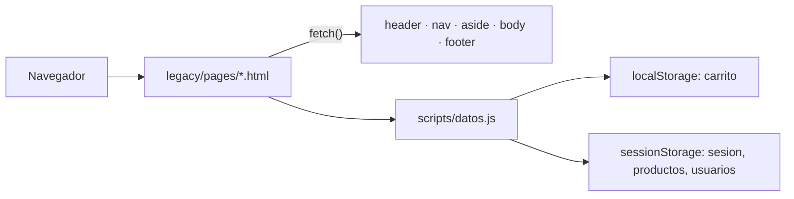
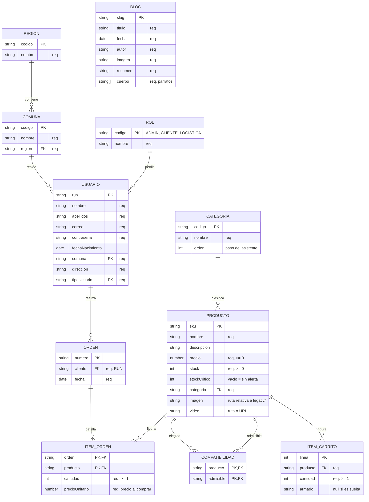

# Ensambla.me

Tienda online de componentes de PC con asistente de armado guiado por compatibilidad.
Frontend estático sin backend. Duoc UC · DSY1104 Desarrollo Fullstack II · Entrega I.
ERS rev. 2.4 (01-10-2026), Daniel Muñoz. La versión formal IEEE 830 está en
`ERS - Ensambla.me.docx`.

## Índice

- [1. Ejecución](#1-ejecución)
- [2. Stack y restricciones](#2-stack-y-restricciones)
- [3. Arquitectura](#3-arquitectura)
  - [3.1 Composición de vistas](#31-composición-de-vistas)
  - [3.2 Estado en el cliente](#32-estado-en-el-cliente)
  - [3.3 Roles](#33-roles)
- [4. Modelo de datos](#4-modelo-de-datos)
- [5. Reglas de validación](#5-reglas-de-validación)
- [6. Requisitos funcionales](#6-requisitos-funcionales)
- [7. Requisitos no funcionales](#7-requisitos-no-funcionales)
- [8. Fuera de alcance](#8-fuera-de-alcance)
- [9. Desviaciones respecto del Anexo 1](#9-desviaciones-respecto-del-anexo-1)

## 1. Ejecución

Aplicación React + Vite (migración de la Evaluación 2 en curso). Requiere Node ≥ 22.22.

```
npm install
npm run dev        # http://localhost:5173/
npm test           # Vitest en modo watch (npm run test:run: una sola pasada)
npm run coverage   # cobertura v8: tabla en consola + coverage/index.html
npm run build      # salida en dist/
npm run lint
```

Rutas de la app: `/`, `/productos` (filtros en la URL: `?q=`, `categoria`, `min`, `max`,
`oferta`, `stock`, `orden`), `/productos/:sku`, `/categorias`, `/ofertas`, `/armado`,
`/carrito`, `/checkout`, `/pago/correcto/:numero`, `/pago/error`, `/blogs`, `/blogs/:slug`,
`/nosotros`, `/contacto`, `/registro`, `/login`, `/creditos`, `/perfil` y `/mis-compras`
(`/mis-compras/:numero`, con sesión) y el panel en `/admin` (`/admin/productos`,
`/admin/productos/criticos`, `/admin/categorias`, `/admin/usuarios`, `/admin/ordenes`,
`/admin/reportes` y `/admin/perfil`, con `nuevo`/`nueva`, `:id/editar` y la ficha
`/admin/usuarios/:run` en los mantenedores). Imágenes y video se sirven desde `public/resources/`.

La capa de datos (`src/data/datos.js`) ofrece CRUD completo de productos, usuarios y
categorías sobre una copia de trabajo en `sessionStorage`; `DatosProvider` la conecta
con los componentes para que cada cambio se vea sin recargar.

El sitio de la Entrega I (HTML, CSS y JS sin framework) se conserva en `legacy/` como
referencia mientras dura la migración; `legacy/resources` es un enlace simbólico a
`public/resources`. Requiere un servidor HTTP: con `file://` no carga las secciones que
se traen con `fetch()`.

```
python3 -m http.server 8000   # desde la raíz del repo
# http://localhost:8000/legacy/pages/index.html
```

Las secciones 2 a 9 describen todavía el sitio de `legacy/`; se actualizan en el ERS v2.

| Rol                     | Correo             | Contraseña   |
|-------------------------|--------------------|--------------|
| Administrador           | `admin@duoc.cl`    | `admin1234`  |
| Administrador logístico | `bodega@duoc.cl`   | `bodega123`  |
| Cliente                 | `camila@gmail.com` | `cliente123` |

Pago simulado en `/checkout` (no hay cobro real ni se guarda la tarjeta). Tarjetas de
prueba: `4242 4242 4242 4242` aprueba, `4000 0000 0000 0002` la rechaza el emisor y
`4000 0000 0000 9995` por fondos insuficientes. Cualquier vencimiento futuro (MM/AA) y
un CVV de 3 o 4 dígitos. Se puede comprar sin sesión; con sesión, los datos se completan
solos. Cada compra crea una orden con su boleta y descuenta el stock.

## 2. Stack y restricciones

- HTML5 semántico, CSS propio y JavaScript sin framework, más Bootstrap 5.3.8 en copia
  local en `legacy/bootstrap/`, sin CDN.
- Sin backend ni base de datos. Los datos viven en arreglos JS y en Web Storage.
- Solo peticiones HTTP GET del mismo origen, sin APIs externas.
- Una hoja de estilos propia (`legacy/styles/style.css`), sin `style=""` ni `<style>`.
- Marcado válido en el validador del W3C. Diseño responsivo sin scroll horizontal.
- Navegadores objetivo: Chrome, Firefox y Edge en sus versiones actuales.

## 3. Arquitectura



### 3.1 Composición de vistas

`includes.js` reemplaza cada nodo `data-include="x.html"` por el contenido del partial.
Reescribe las rutas relativas del partial (`href`, `src`, `poster`, `action`,
`data-include`) respecto de la URL del propio partial y al terminar emite
`includes:loaded`, el evento del que dependen todos los scripts de vista.

```
legacy/
├── pages/            index.html (+ body.html), productos, producto, armado, carrito,
│   │                 blogs, blog, nosotros, contacto, registro, login, creditos
│   │                 partials: header, nav, aside, footer
│   └── admin/        index, productos, producto, usuarios, usuario, ordenes, orden
│                     partial: aside (menú construido por rol)
├── scripts/          includes, datos, sesion, validaciones, catalogo, carrito,
│                     armado, blogs, mantenedores
├── styles/style.css
├── resources/        img/ (productos/<SKU>.webp, SVG), video/ensamblame.mp4
└── bootstrap/
```

### 3.2 Estado en el cliente

| Almacén          | Clave                   | Contenido                                                                    | Vida                                              |
|------------------|-------------------------|------------------------------------------------------------------------------|---------------------------------------------------|
| `localStorage`   | `carrito`               | JSON `[{linea, producto, cantidad, armado}]` (`armado` es `null` en las sueltas). Si es corrupto, se reinicia vacío| Persistente; no se borra al cerrar sesión         |
| `sessionStorage` | `sesion`                | RUN, nombre, apellidos, correo y rol                                         | Hasta el logout o el cierre del navegador         |
| `sessionStorage` | `productos`, `usuarios` | Copia de trabajo sembrada desde `datos.js`, donde escriben RF-01, RF-10 y RF-11 | Sesión del navegador                              |

### 3.3 Roles

| Rol                     | Acceso                                                                                                                 |
|-------------------------|------------------------------------------------------------------------------------------------------------------------|
| Cliente                 | Tienda pública                                                                                                         |
| Administrador           | Tienda y panel completo: mantenedores de Productos y Usuarios, Órdenes                                                 |
| Administrador logístico | Productos y órdenes en solo lectura. El resto del menú no existe en el DOM                                             |

`Sesion.proteger([...])`: sin sesión redirige a `login.html?destino=…`; con un rol no
autorizado muestra «Acceso denegado» y no renderiza la vista.

## 4. Modelo de datos

Nombres de campo idénticos a los de `datos.js`. `"req"` = obligatorio.



| Datos                                                                                      | Origen                                         | Escritura                                                                 |
|--------------------------------------------------------------------------------------------|------------------------------------------------|---------------------------------------------------------------------------|
| `categorias`, `compatibilidad`, `regiones`, `comunas`, `roles`, `ordenes`, `itemsOrden`, `blogs` | Constantes de `datos.js`                       | Solo lectura                                                              |
| `productos`, `usuarios`                                                                    | Semilla en `datos.js` (`Datos.semillas`)       | Copia de trabajo en `sessionStorage` (`Datos.productos()` / `guardarProductos()`, ídem usuarios) |
| Ítem carrito                                                                               | —                                              | `localStorage.carrito` (`carrito.js`)                                     |

- Formatos de clave:
  - Comuna: `RM-02`, generada como región más índice.
  - Orden: `ORD-2026-0001`.
  - Armado: `ARM-<Date.now() en base 36>`.
  - RUN con el DV incluido, sin puntos ni guion.
- Fechas en ISO `YYYY-MM-DD`.
- `compatibilidad` se genera con `flatMap` a partir del mapa `paresDeCompatibilidad`
  (SKU → SKU admisibles de la categoría siguiente).
- Armado no es una relación propia: es el valor `armado` que comparten las líneas de
  carrito de un mismo grupo.
- No se almacenan derivados: total de la orden, subtotal y precio del armado se calculan
  al mostrarse. La región del usuario se obtiene de su comuna.
- El modelo está en 3NF, salvo `Blog.cuerpo`, que se guarda como `string[]` por
  simplicidad. En una base de datos real sería la relación Párrafo (`blog`, `n`, `texto`).

## 5. Reglas de validación

La validación es en tiempo real (`input`/`blur`) y el error aparece junto al campo. Cada
campo con formato muestra una sugerencia (`form-text`) antes de cualquier error.

| Campo                     | Regla                                                                                     |
|---------------------------|-------------------------------------------------------------------------------------------|
| RUN                       | Requerido, 7–9 caracteres, sin puntos ni guion, DV módulo 11. Ej. válido: `190110222`     |
| Correo                    | Requerido, ≤ 100, dominio `@duoc.cl`, `@profesor.duoc.cl` o `@gmail.com` (con `datalist`) |
| Contraseña                | Requerida, 4–10 caracteres, `type="password"`                                             |
| Nombre / apellidos        | Requeridos, ≤ 50 / ≤ 100                                                                  |
| Región → comuna           | Requeridas; el select de comuna se filtra por la región elegida                           |
| Dirección                 | Requerida, ≤ 300                                                                          |
| Fecha de nacimiento       | Opcional                                                                                  |
| Contacto: nombre / comentario | Requeridos, ≤ 100 / ≤ 500                                                             |
| SKU                       | Requerido, ≥ 3, único                                                                     |
| Nombre / descripción de producto | Requerido ≤ 100 / opcional ≤ 500                                                   |
| Precio                    | Requerido, ≥ 0, admite decimales; 0 = gratis                                              |
| Stock / stock crítico     | Requerido / opcional; enteros ≥ 0                                                         |
| Categoría                 | Requerida (select)                                                                        |
| Imagen / video            | Opcionales (ruta o URL)                                                                   |

## 6. Requisitos funcionales

El código cita los criterios como `RF-xx CAn`. La numeración es estable y RF-16 queda
retirado.

**RF-01 Registrar usuario** · Cliente · `registro.html`, `validaciones.js`
1. Si falta un campo requerido, no se envía y se marca cada campo faltante.
2. `190110222` se acepta. Con puntos, guion o DV incorrecto (`19.011.022-3`) aparece
   «RUN inválido» y no se envía.
3. Con un dominio no permitido (`juan@hotmail.com`), el error lista los dominios
   aceptados.
4. Una contraseña fuera de 4–10 caracteres da error.
5. Al cambiar la región, el select de comuna se recarga solo con las de esa región.
6. No se pueden superar los máximos; si se superan, aparece el error.
7. Un formulario válido agrega el usuario a `usuarios` y muestra una confirmación.
8. El correo ofrece los dominios permitidos vía `datalist`.

**RF-02 Iniciar sesión** · todos · `login.html`, `sesion.js`
1. Con credenciales válidas se inicia sesión y se redirige según el rol: Cliente →
   tienda; Administrador → panel (RF-10, RF-11); Logístico → RF-12.
2. Un dominio inválido o una contraseña fuera de 4–10 caracteres dan error y no se
   envía.
3. Sin coincidencia aparece un mensaje genérico, «correo o contraseña incorrectos».

**RF-03 Catálogo** · Cliente · `index.html`, `productos.html`, `catalogo.js`
1. Hay una tarjeta (imagen, nombre, precio) por producto, generada desde los datos:
   agregar un producto a `datos.js` lo muestra sin tocar el HTML.
2. Precios en CLP.
3. Con el arreglo vacío aparece «no hay productos disponibles».

**RF-04 Detalle de producto** · Cliente · `producto.html`, `catalogo.js`
1. Un clic en la tarjeta abre el detalle de ese producto.
2. El detalle muestra imagen, nombre, precio, descripción, categoría y un «Añadir al
   carrito» operativo.
3. Un SKU inexistente muestra «producto no encontrado», sin error de JS.
4. Si existe `video`, se embebe y se reproduce. Si no existe, no queda ningún
   contenedor vacío.

**RF-05 Agregar al carrito** · Cliente · `productos.html`, `producto.html`, `carrito.js`, `catalogo.js`

Invariante: las unidades de un SKU en el carrito, sumando líneas sueltas y armados,
nunca superan su `stock`.
1. Añadir, desde el listado o el detalle, suma 1 al contador y persiste de inmediato
   en `localStorage`.
2. Un SKU ya presente incrementa su cantidad; no se duplica la línea.
3. Cada adición tiene confirmación visual.
4. Con `stock` 0, el botón queda deshabilitado con «Sin stock», en el listado y en el
   detalle.
5. Si se excede el stock, se rechaza con las unidades disponibles y el carrito no
   cambia (con stock 2, la 3.ª unidad se rechaza).

**RF-06 Gestionar carrito** · Cliente · `carrito.html`, `carrito.js`
1. Cada línea muestra imagen, nombre, precio unitario, cantidad y subtotal.
2. Al eliminar una línea, se quita y el total se recalcula sin recargar.
3. Al cambiar la cantidad se recalculan el subtotal y el total (Σ precio × cantidad).
   El mínimo es 1 y el máximo es el stock menos las otras líneas del mismo SKU; un valor
   mayor se ajusta al máximo con un mensaje.
4. El carrito persiste tras recargar o reabrir el navegador. Si el stock bajó, la
   cantidad se ajusta y la línea sin unidades se quita.
5. Vacío: muestra un mensaje y el total es 0.

**RF-07 Asistente de armado** · Cliente · `armado.html`, `armado.js`, `carrito.js`

Orden: CPU → placa madre → RAM → almacenamiento → fuente → gabinete → refrigeración →
GPU → periféricos. Modos *completo* y *módulos*. El filtrado sale de la tabla estática
`Compatibilidad`, sin cálculo técnico real.
1. Una categoría a la vez, en orden fijo.
2. La categoría siguiente lista solo los admisibles del componente elegido (una CPU
   de un socket no ofrece placas de otro).
3. En modo módulos se puede finalizar antes y se agregan solo los componentes
   elegidos.
4. En modo completo, recorrer todas las categorías agrega el conjunto completo.
5. En el carrito, el armado es un grupo identificable, con detalle de componentes y
   precio igual a la suma.
6. No se emite juicio técnico: si la tabla asocia dos componentes, se aceptan.
7. Un componente con stock 0 aparece como «sin stock» y no se puede elegir. Si al
   finalizar falta stock (RF-05), el armado no se agrega y se nombran los componentes
   faltantes.

**RF-08 Contacto** · Cliente · `contacto.html`, `validaciones.js`
1. Con nombre, correo o comentario vacíos no se envía y aparece el error en cada campo.
2. Con un dominio no permitido, el error lista los dominios aceptados.
3. No se puede pasar de nombre > 100 ni de comentario > 500; si se pasa, aparece el
   error.
4. Un formulario válido muestra un mensaje de éxito y limpia los campos.

**RF-09 Blogs** · Cliente · `blogs.html`, `blog.html`, `blogs.js`
1. Listado con imagen, título y descripción corta.
2. Detalle con imagen, título y descripción larga; al menos 2 artículos navegables.

**RF-10 Mantenedor de Productos** · Administrador · `admin/productos.html`, `admin/producto.html`, `mantenedores.js`
1. El listado ofrece crear y editar. Lo creado aparece en el listado y lo editado se
   refleja.
2. Se rechazan un SKU de menos de 3 caracteres, un precio menor que 0 y un stock
   negativo o decimal. El precio admite decimales y el 0 se acepta.
3. Sin categoría no se envía.
4. Si `stock` ≤ `stockCritico`, el listado muestra una alerta.
5. El `video` se conserva y el detalle lo embebe; vacío no bloquea el guardado.
6. No hay acción Eliminar.

**RF-11 Mantenedor de Usuarios** · Administrador · `admin/usuarios.html`, `admin/usuario.html`, `mantenedores.js`
1. El listado ofrece crear y editar. Lo creado aparece en el listado y lo editado se
   refleja.
2. Aplica las mismas validaciones que RF-01, incluidos RUN y contraseña.
3. El select de tipo ofrece exactamente Administrador, Cliente y Administrador
   logístico, y no existe en el registro público.
4. El usuario creado accede solo a lo que permite su rol.
5. No hay acción Eliminar.

**RF-12 Productos y órdenes en lectura** · Logístico · `admin/productos.html`, `admin/ordenes.html`, `admin/orden.html`, `sesion.js`
1. El listado de productos no tiene crear, editar ni eliminar.
2. Cada orden muestra cliente, fecha, productos y total; su detalle es de solo
   lectura.

**RF-13 Cerrar sesión** · todos · `header.html`, `sesion.js`
1. La opción es visible en toda vista accesible con sesión iniciada.
2. Borra `sessionStorage.sesion` y redirige a la tienda.
3. No borra `carrito`: el carrito pertenece al navegador, no al usuario.

**RF-14 Navegación** · Cliente · `nav.html`, `aside.html`, `carrito.js`, `catalogo.js`
1. Cada enlace del menú lleva a su vista; el logo lleva al inicio.
2. El contador del carrito se actualiza al agregar o quitar productos.
3. Cada categoría de la barra lateral lleva a `productos.html?categoria=…`.

**RF-15 Nosotros** · Cliente · `nosotros.html`
1. Describe la empresa y presenta a sus desarrolladores.

## 7. Requisitos no funcionales

**RNF-01 Rendimiento** · `includes.js`, `style.css`
1. Por HTTP, en banda ancha y con la caché deshabilitada, cada vista carga en menos
   de 2 s.
2. Solo hay peticiones del mismo origen.
3. La composición por `fetch()` termina antes de la interacción y no deja contenedores
   vacíos permanentes.

**RNF-02 Seguridad** · `sesion.js`, `validaciones.js`
1. Abrir una URL de admin sin sesión lleva al login; con rol Cliente, o después del
   logout, el acceso se deniega.
2. El rol Logístico ve en el menú solo Productos y Órdenes. Las demás opciones no
   existen en el DOM: no basta con ocultarlas por CSS.
3. Todo campo de contraseña usa `type="password"`.
4. Un valor inválido muestra el error antes de enviar.
5. RUN, correo y contraseña muestran una sugerencia de formato antes de enviar,
   distinta del mensaje de error.
6. Si el rol Logístico abre por URL un formulario de crear o editar, el acceso se
   deniega sin renderizarlo.

**RNF-03 Fiabilidad** · `includes.js`, `carrito.js`
1. No hay errores de JS en la consola en ninguna vista.
2. Si un partial falla, el error queda en la consola y el resto de la página sigue
   usable.
3. El error de validación aparece junto al campo y la navegación sigue disponible.
4. Si `carrito` es inválido o está corrupto, el carrito se inicia vacío sin
   interrumpir la ejecución.

**RNF-04 Disponibilidad** · hosting
1. El sitio es accesible por su URL pública sin credenciales. La disponibilidad es la
   del hosting.

**RNF-05 Mantenibilidad** · `index.html`, `includes.js`, `style.css`
1. Cada sección (header, nav, aside, body, footer) tiene su archivo en `legacy/pages/` y
   se incluye con `data-include`.
2. Hay una única hoja propia, `legacy/styles/style.css`, sin `style=""` ni `<style>`.
3. Un cambio en un partial se refleja en todas las vistas editando un solo archivo.
4. Estructura con `header`/`nav`/`main`/`section`/`article`/`footer` y no con `div`;
   un solo `<h1>` por vista; texto en encabezados, párrafos y listas.
5. Cada control tiene un `<label for>` que coincide con su `id`.
6. Cada campo declara el `autocomplete` correspondiente.
7. Servido por HTTP, el marcado pasa `validator.w3.org` sin errores.

**RNF-06 Portabilidad** · `style.css`, `includes.js`
1. Funciona en Chrome, Firefox y Edge actuales servido por HTTP; con `file://` no
   carga las secciones.
2. No requiere build, instalación ni configuración del sistema operativo.
3. No hay scroll horizontal en escritorio, tablet ni móvil.

**RNF-07 Repositorio** · organización
1. El repositorio de GitHub es público y no requiere credenciales.
2. Los commits son claros y documentan el avance.
3. El README documenta cómo ejecutar el proyecto localmente ([§1](#1-ejecución)).
4. El `.zip` entregado corresponde al estado publicado.
5. Modalidad individual autorizada por el docente: el historial es de un solo autor.

**RNF-08 Interfaces** · `header.html`, `nav.html`, `aside.html`, `footer.html`, `nosotros.html`, `admin/index.html`
1. Toda vista pública tiene un menú superior con el logo, Inicio, Productos, Blogs,
   Nosotros, Contacto y el carrito con contador.
2. En el inicio, el hero (información e imagen) aparece antes del listado y el video
   demostrativo del asistente va después.
3. Toda vista de tienda tiene la barra lateral de categorías.
4. El pie muestra nombre, enlaces principales, contacto y año.
5. El home de admin tiene un menú vertical hacia RF-10 y RF-11.
6. «Nosotros» es accesible desde el menú de cualquier vista pública.

## 8. Fuera de alcance

- Backend, base de datos y persistencia entre dispositivos: lo creado se pierde al
  cerrar el navegador.
- Pasarela de pago y ciclo de orden completo (crear órdenes desde el carrito, estado,
  historial).
- Eliminar en los mantenedores.
- Reportes y estadísticas.
- Recuperación de contraseña y verificación de correo.
- Motor de compatibilidad real (socket, tipo de RAM, formato, potencia), que
  reemplazaría la tabla estática.

## 9. Desviaciones respecto del Anexo 1

- Se agrega `contrasena` a Usuario, requerida en el registro y en el mantenedor.
- El correo de contacto pasa a ser requerido.
- Región y comuna son requeridas, pero solo se almacena la comuna.
- Se agrega `video` a Producto para el video embebido del detalle.
- Se agrega `numero` a Orden como PK para que el detalle sea navegable.
- El rol «Vendedor» pasa a llamarse «Administrador logístico».
